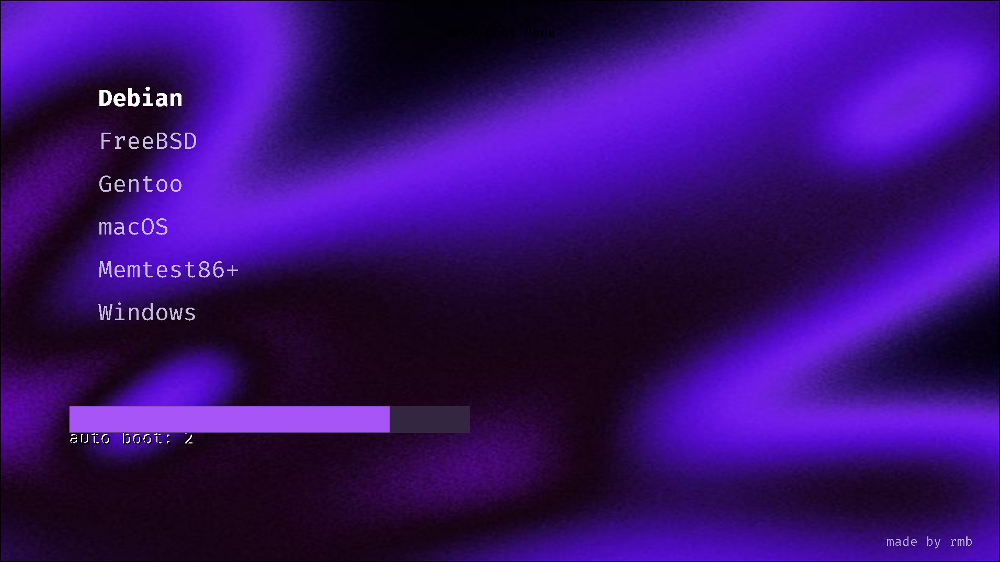

# grub-prpl

Purple GRUB theme with a quiet yazi-inspired layout.

## Preview

```sh
grub2-theme-preview . --resolution 1024x768 --display gtk --no-kvm --timeout 10
```

## Install

```sh
sudo ./install.sh
sudo grub-mkconfig -o /boot/grub/grub.cfg
```

To add optional power entries:

```sh
sudo sh -c 'cat 40_custom.extra >> /etc/grub.d/40_custom'
sudo grub-mkconfig -o /boot/grub/grub.cfg
```

